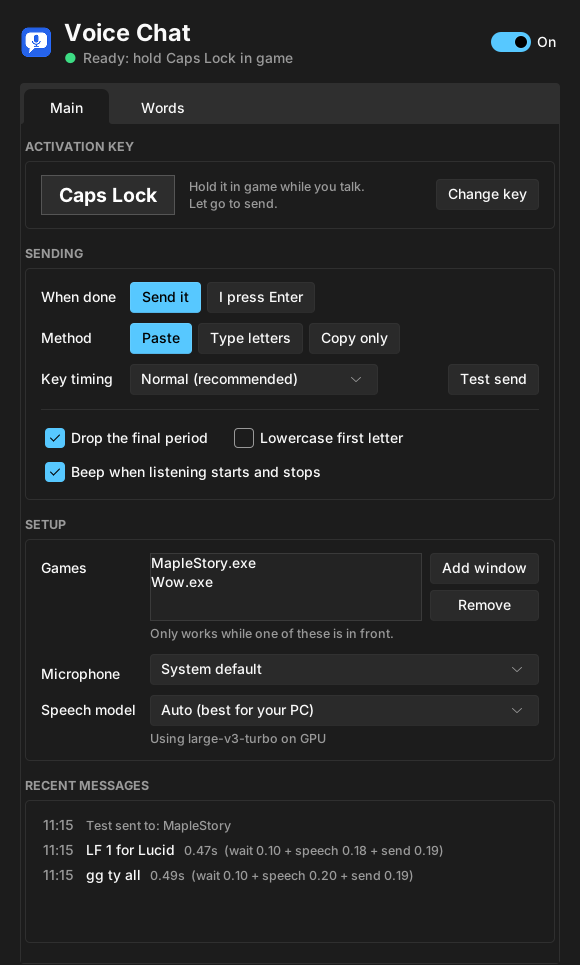
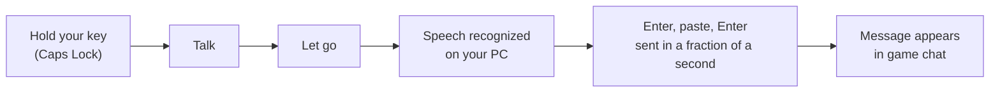
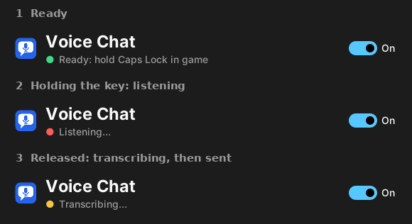
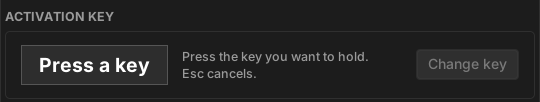
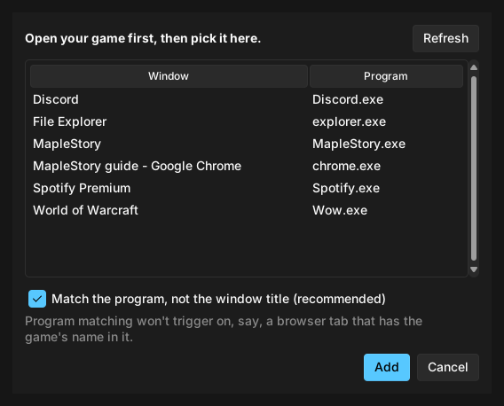
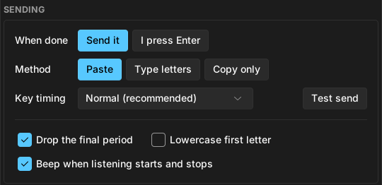
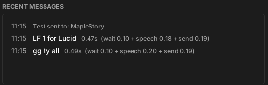
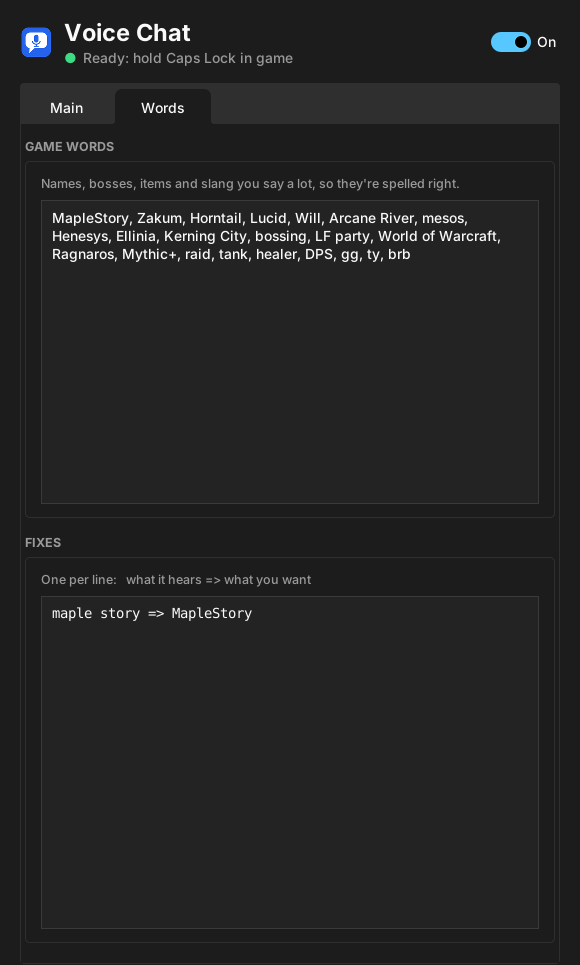

# MapleStory Speech to Text Accessibility Tool

Hold a key, say what you want to type, let go, and your words appear in MapleStory's chat. No typing needed.

Built for players who find typing in chat hard or slow mid-game: hands busy with skills, RSI, limited mobility, or just faster talking than typing. Speech recognition runs **locally on your PC** with [faster-whisper](https://github.com/SYSTRAN/faster-whisper); nothing you say is sent anywhere.

Also works with World of Warcraft or any other game with an Enter-to-chat box.

<p align="center">
  
</p>

## Contents

- [How it works](#how-it-works)
- [Using it, step by step](#using-it-step-by-step)
- [System requirements](#system-requirements)
- [Install and run](#install-and-run)
- [Build a standalone .exe](#build-a-standalone-exe)
- [Settings](#settings)
- [Troubleshooting](#troubleshooting)
- [License](#license)
- [Disclaimer](#disclaimer)

## How it works



The status line at the top of the window shows what it's doing. Green means ready, red means it's listening while you hold the key, and yellow means it's turning your speech into text and sending it.

<p align="center">
  
</p>

Sending takes a fraction of a second, so the chat box is only open briefly and your skill keys keep working.

## Using it, step by step

### 1. Pick your push-to-talk key

Caps Lock is the default. Click **Change key** and press any key you don't use in game. Enter can't be used, because the tool needs it to open chat.

<p align="center">
  
</p>

### 2. Choose the games it works in

Click **Add window** with your game open, and pick it from the list of open windows. The tool only grabs your key while one of these games is in front; everywhere else the key works normally. Matching by program (like `MapleStory.exe`) is recommended, so a browser tab with "MapleStory" in its title won't trigger it.

<p align="center">
  
</p>

### 3. Choose how messages are sent

- **When done:** *Send it* sends the message automatically. *I press Enter* leaves it in the chat box so you can check it first.
- **Method:** *Paste* is fastest. *Type letters* is for games that ignore pasting. *Copy only* copies the text and beeps twice, and you press Enter, Ctrl+V, Enter yourself.
- **Key timing:** if the game misses key presses, switch to *Slow*.
- **Test send:** click it, switch to your game within 3 seconds, and it sends "voice chat test" so you can check everything without talking.

<p align="center">
  
</p>

### 4. Talk

Hold your key in game, say your message, let go. Every message shows up under **Recent messages** with how long each step took: the short recording tail after you let go, speech recognition, and sending.

<p align="center">
  
</p>

### 5. Teach it your game's words (optional)

On the **Words** tab, list names it should expect: your IGN, guild, bosses, items, slang. Under **Fixes**, correct words it keeps mishearing, one per line, like `hey knee => Hayne`.

<p align="center">
  
</p>

## System requirements

| | Minimum | Recommended |
| --- | --- | --- |
| **OS** | Windows 10 (64-bit) | Windows 11 |
| **CPU** | 4 cores | 6+ cores |
| **RAM** | 8 GB | 16 GB |
| **Graphics** | None required (runs on the CPU) | NVIDIA GTX 16-series / RTX 20-series or newer, 4 GB+ VRAM |
| **NVIDIA driver** | – | 527.41 or newer (CUDA 12 support) |
| **Disk space** | About 2 GB | About 5 GB with GPU support |
| **Microphone** | Any | A headset or desk mic close to your mouth |
| **Other** | Administrator rights; internet on first launch to download the speech model | |

Notes:
- **With an NVIDIA GPU** it uses the large-v3-turbo model: the most accurate option, and typically well under half a second per message.
- **Without one** it uses the smaller small.en model on the CPU. It works, but recognition is slower (often around a second or more per message) and a bit less accurate. Pick *Fastest (base.en)* under Speech model on older PCs.
- **AMD and Intel graphics cards** aren't used for acceleration; the tool falls back to the CPU.
- **Speech model downloads** (once, on first use): base.en ~140 MB, small.en ~460 MB, medium.en ~1.5 GB, large-v3-turbo ~1.6 GB.
- **Administrator rights** are needed because Windows blocks key presses into games that run as administrator, which MapleStory does.

## Install and run

You'll need **Python 3.12 or newer** from [python.org](https://www.python.org/downloads/). Tick **"Add python.exe to PATH"** on the installer's first screen.

```bat
pip install -r requirements.txt
```

For NVIDIA GPU speed-up, also install:

```bat
pip install nvidia-cublas-cu12 "nvidia-cudnn-cu12==9.*"
```

Then double-click `voice_chat.pyw` and approve the administrator prompt. The first launch downloads the speech model, which takes a few minutes; the status dot turns green when it's ready.

## Build a standalone .exe

Double-click **`Build VoiceChat.bat`**. It installs everything, asks whether you have an NVIDIA card, builds `dist\VoiceChat\VoiceChat.exe` with PyInstaller, and puts a **Voice Chat** shortcut on your desktop.

`Build VoiceChat (no questions).bat` does the same with automatic GPU detection and writes all output to `build_log.txt`.

Notes:
- The app is a folder (`dist\VoiceChat\`) rather than a single file, so it starts quickly. With GPU support it's about 2 GB; keep it outside OneDrive or other synced folders.
- The .exe isn't code-signed, so Windows SmartScreen may warn the first time. Click **More info, Run anyway**.

## Settings

Settings save automatically to `%APPDATA%\VoiceChat\settings.json`.

| Setting | What it does |
| --- | --- |
| Activation key | The key you hold while talking. Enter can't be used. |
| When done | *Send it* sends automatically; *I press Enter* leaves the text in chat for you to send. |
| Method | *Paste*, *Type letters*, or *Copy only*. |
| Key timing | *Fast*, *Normal* or *Slow*. Use Slow if the game misses key presses. |
| Games | Windows the tool works in. Matching by program (e.g. `MapleStory.exe`) is recommended. Empty list = every window. |
| Microphone | Which microphone to listen to. |
| Speech model | *Auto* picks large-v3-turbo on GPU or small.en on CPU. Smaller models are faster but less accurate. |

## Troubleshooting

- **Messages show in "Recent messages" but nothing appears in game.** Try *Key timing: Slow*, then *Type letters*. Use *Test send* to check without talking.
- **Nothing happens when holding the key.** Make sure the game is listed under *Games* and is the window in front, and that the switch at the top is on.
- **Another app also uses Caps Lock** (Wispr Flow, for example). Change the activation key, or close the other app while playing.
- **The status dot stays gray.** The speech model is still downloading on first launch; give it a few minutes.
- **Last word gets cut off.** Keep holding the key until you finish speaking.

## License

[MIT](LICENSE): free to use, modify and share, including in your own projects. Keep the copyright notice.

## Disclaimer

This is an unofficial fan-made accessibility tool. It is not affiliated with or endorsed by Nexon or Blizzard. It only types chat messages you speak and never automates gameplay, but it sends simulated key presses to the game, and game anti-cheat policies can change. Use at your own risk; consider asking the game's support team if they allow speech-to-text tools.

<sub>Screenshots show the app with sample messages.</sub>
