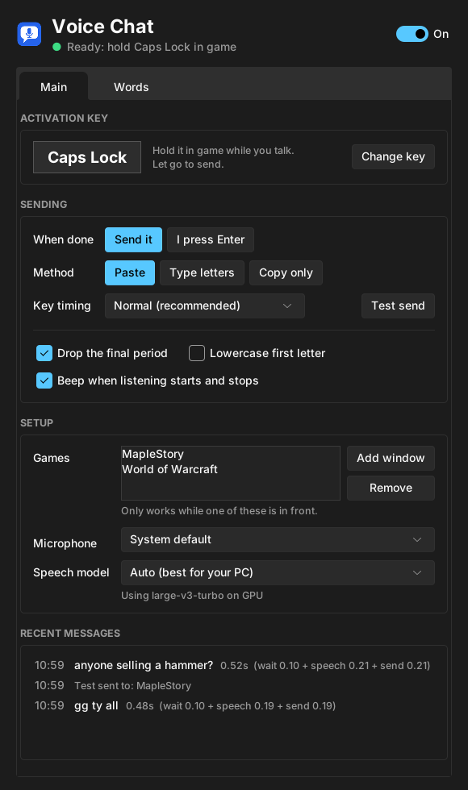

# MapleStory Speech to Text Accessibility Tool

Hold a key, say what you want to type, let go, and your words appear in MapleStory's chat. No typing needed.

Built for players who find typing in chat hard or slow mid-game: hands busy with skills, RSI, limited mobility, or just faster talking than typing. Speech recognition runs **locally on your PC** with [faster-whisper](https://github.com/SYSTRAN/faster-whisper); nothing you say is sent anywhere.

Also works with World of Warcraft or any other game with an Enter-to-chat box.



## How it works

1. Hold your activation key (Caps Lock by default) while the game is in front.
2. Talk.
3. Let go. The tool transcribes what you said, presses Enter to open chat, pastes the text, and presses Enter to send. Sending takes a fraction of a second, so it doesn't get in the way of your skill keys.

## Features

- **Push-to-talk with any key.** Click *Change key* and press the one you want.
- **Only active in your games.** Pick game windows from a list of open windows; everywhere else the key works normally.
- **Fast, local speech recognition.** Uses your NVIDIA GPU when available (large-v3-turbo), or a smaller model on the CPU.
- **Three ways to send.** Paste (fastest), type letters (if paste doesn't work in a game), or copy only (you press Enter, Ctrl+V, Enter yourself).
- **Adjustable key timing** for games that miss quick key presses, plus a **Test send** button.
- **Game vocabulary and fixes.** Teach it boss names, your IGN and slang, and auto-correct words it keeps mishearing.
- **Latency breakdown** for every message, so you can see where the time goes.


## Requirements

- Windows 10 or 11
- Python 3.12 or newer, with "Add python.exe to PATH" ticked during install
- A microphone
- Optional: an NVIDIA graphics card for faster, more accurate recognition

## Install and run

```bat
pip install -r requirements.txt
```

For NVIDIA GPU speed-up, also install:

```bat
pip install nvidia-cublas-cu12 "nvidia-cudnn-cu12==9.*"
```

Then double-click `voice_chat.pyw`. It asks for administrator rights, which Windows requires for sending keys to MapleStory. The first launch downloads the speech model, which takes a few minutes; the status dot turns green when it's ready.

## Build a standalone .exe

Double-click **`Build VoiceChat.bat`**. It installs everything, asks whether you have an NVIDIA card, builds `dist\VoiceChat\VoiceChat.exe` with PyInstaller, and puts a **Voice Chat** shortcut on your desktop.

`Build VoiceChat (no questions).bat` does the same with automatic GPU detection and writes all output to `build_log.txt`.

Notes:
- The app is a folder (`dist\VoiceChat\`) rather than a single file, so it starts quickly. With GPU support it's about 2 GB; keep it outside OneDrive or other synced folders.
- The .exe isn't code-signed, so Windows SmartScreen may warn the first time. Click **More info, Run anyway**.

## Settings

Settings save automatically to `%APPDATA%\VoiceChat\settings.json`.

| Setting | What it does |
| --- | --- |
| Activation key | The key you hold while talking. Enter can't be used. |
| When done | *Send it* sends automatically; *I press Enter* leaves the text in chat for you to send. |
| Method | *Paste*, *Type letters*, or *Copy only*. |
| Key timing | *Fast*, *Normal* or *Slow*. Use Slow if the game misses key presses. |
| Games | Windows the tool works in. Matching by program (e.g. `MapleStory.exe`) is recommended. |
| Speech model | *Auto* picks large-v3-turbo on GPU or small.en on CPU. Smaller models are faster but less accurate. |

## Troubleshooting

- **Messages show in "Recent messages" but nothing appears in game.** Try *Key timing: Slow*, then *Type letters*. Use *Test send* to check without talking.
- **Nothing happens when holding the key.** Make sure the game is listed under *Games* and is the window in front, and that the switch at the top is on.
- **Another app also uses Caps Lock** (Wispr Flow, for example). Change the activation key, or close the other app while playing.
- **Last word gets cut off.** Keep holding the key until you finish speaking.

## Disclaimer

This is an unofficial fan-made accessibility tool. It is not affiliated with or endorsed by Nexon or Blizzard. It only types chat messages you speak and never automates gameplay, but it sends simulated key presses to the game, and game anti-cheat policies can change. Use at your own risk; consider asking the game's support team if they allow speech-to-text tools.
